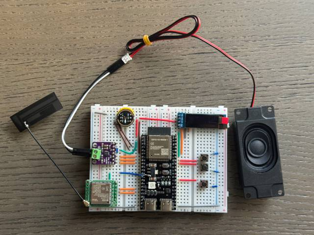
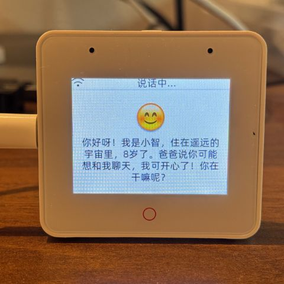
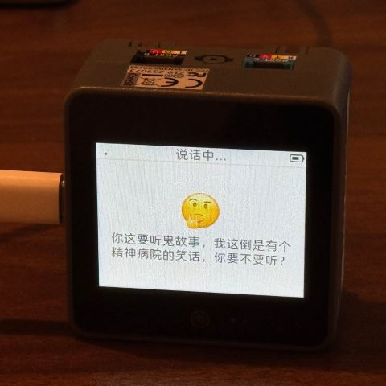
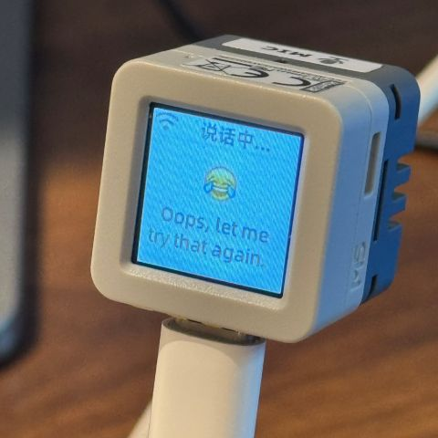
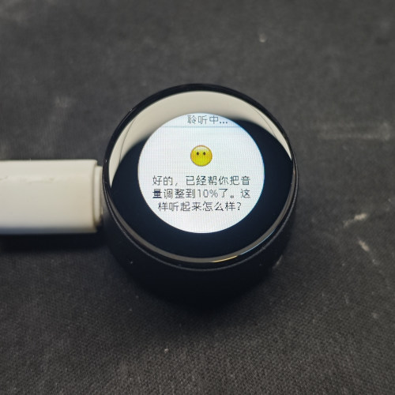

# 车载 AI 行车状态监测与语音交互终端

项目 8 · 车载智能 · ESP32-S3 · car-ai-s3

## 项目简介

本项目面向车内环境监测、人员遗留提醒和语音交互场景，基于 ESP32-S3 开发轻量化车载智能终端，在小智 AI 开源固件基础上扩展车载监测与交互功能。

项目目标是采集车内温湿度、光照等环境数据，通过摄像头抓拍与预览车内画面，为人员遗留监测提供图像输入；利用 FreeRTOS 组织状态监测、图像采集、音频交互、界面刷新和云端上报任务。离线交互规划基于 ESP-Skainet / ESP-SR 实现语音查询温度、播放提示语音等指令，通过 I2S + DMA 完成语音播报与异常提醒；LVGL 界面展示环境数据、抓拍画面和设备状态。联网后规划通过 MQTT 将监测数据上传至巴法云，供手机远程查看，并结合小智 AI 提供智能问答与行车助手功能。

> 以下为项目目标与功能规划；当前代码基础和待开发内容见“当前代码状态”。

## 功能规划

| 模块 | 目标功能 |
| --- | --- |
| 环境监测 | 通过环境传感器采集车内温湿度，使用 ADC 采集模拟光照等信号；具体接口以所选传感器为准，并设置异常阈值。 |
| 图像与人员遗留监测 | 摄像头定时或按需抓拍，显示车内画面；后续结合人员检测结果与车辆状态实现遗留提醒。 |
| FreeRTOS 多任务 | 协调状态监测、图像采集、音频交互、LVGL 刷新和云端上报，处理共享数据同步与任务间通信。 |
| 离线语音 | 基于 ESP-Skainet / ESP-SR 扩展离线指令识别，支持查询温度、播放提示语音，并在断网时保留本地基础交互。 |
| 音频播报 | 使用板载麦克风、音频芯片和扬声器，通过 I2S + DMA 完成音频采集、提示语音播放与异常播报。 |
| LVGL 人机界面 | 展示温湿度、光照、摄像头抓拍画面、联网状态和告警状态。 |
| 联网与云端交互 | 通过 Wi-Fi 联网、MQTT 上报巴法云，支持手机远程查看；对接小智 AI 完成语音问答与行车助手交互。 |

## 硬件组成

| 模块 | 硬件基础 |
| --- | --- |
| 主控与存储 | ESP32-S3-WROOM-1-N16R8，16 MB Flash、8 MB Octal PSRAM。 |
| 显示 | LCD 显示屏，配合 LVGL 展示环境数据、抓拍画面和设备状态。 |
| 摄像头 | DVP 摄像头，用于车内画面抓拍与预览，帧缓冲使用 PSRAM。 |
| 音频 | 麦克风、音频编解码器、功放与扬声器，通过 I2S + DMA 完成采集与播报。 |
| 通信 | Wi-Fi 联网，用于云端数据上报与小智 AI 交互。 |
| 环境传感器 | 温湿度与光照传感器，具体型号和采集接口按项目需求选定。 |

温湿度传感器若采用数字接口，应使用对应驱动读取；模拟光照等信号通过 ADC 采集。

## 当前代码状态

当前仓库已包含以下代码基础，描述的是源码现状，实际运行效果需结合编译、烧录和硬件联调确认：

- **外设驱动**：工程包含 LCD 显示、DVP 摄像头及 I2S 音频相关代码，为图像采集、界面展示和语音交互提供基础。
- **语音与界面**：工程包含 ESP-SR 离线唤醒、音频处理、LVGL 显示和小智 AI 通信相关代码，作为车载交互功能的开发基础。
- **温湿度接口**：[Dht11Sensor](main/dht11_sensor.cc)当前生成虚拟温湿度数据；[MCP 服务](main/mcp_server.cc)已提供温度、湿度和温湿度组合查询接口。接入真实传感器前，数据仅用于功能演示。
- **云端通信**：仓库包含小智 AI 使用的 WebSocket / MQTT + UDP 通信实现；巴法云监测数据上报属于后续独立接入内容。
- **待开发与验证**：真实温湿度与光照采集、车载监测界面、人员遗留检测与告警、离线指令识别、巴法云上报以及多任务稳定性联调。

## 开发计划

[完整项目架构、代码实现与硬件移植计划](docs/development-plan.md)

该文档记录模块接口、硬件移植、资源分配、M0～M8 开发步骤和验收标准；当前尚未开始代码实现。

## 专业技能

ESP-IDF 嵌入式开发、FreeRTOS 多任务调度与同步、ADC 环境信号采集与传感器驱动、摄像头抓拍与预览、I2S + DMA 音频采集与播报、ESP-Skainet / ESP-SR 离线语音、LVGL 人机界面、Wi-Fi 联网、MQTT 数据上传、巴法云远程监控、小智 AI 语音交互。

## 上游项目说明

本项目基于虾哥开源的小智 AI（xiaozhi-esp32）固件进行场景扩展，沿用仓库的 MIT 许可证。下方保留上游硬件、开发环境与协议资料，便于继续开发。

上游其他语言说明：[English](README_en.md) · [日本語](README_ja.md)

### 上游演示视频

👉 [人类：给 AI 装摄像头 vs AI：当场发现主人三天没洗头【bilibili】](https://www.bilibili.com/video/BV1bpjgzKEhd/)

👉 [手工打造你的 AI 女友，新手入门教程【bilibili】](https://www.bilibili.com/video/BV1XnmFYLEJN/)

## 上游硬件参考

### 面包板手工制作实践

详见飞书文档教程：

👉 [《小智 AI 聊天机器人百科全书》](https://ccnphfhqs21z.feishu.cn/wiki/F5krwD16viZoF0kKkvDcrZNYnhb?from=from_copylink)

面包板效果图如下：

### 支持 70 多个开源硬件（仅展示部分）

- <a href="https://oshwhub.com/li-chuang-kai-fa-ban/li-chuang-shi-zhan-pai-esp32-s3-kai-fa-ban" target="_blank" title="立创·实战派 ESP32-S3 开发板">立创·实战派 ESP32-S3 开发板</a>
- <a href="https://github.com/espressif/esp-box" target="_blank" title="乐鑫 ESP32-S3-BOX3">乐鑫 ESP32-S3-BOX3</a>
- <a href="https://docs.m5stack.com/zh_CN/core/CoreS3" target="_blank" title="M5Stack CoreS3">M5Stack CoreS3</a>
- <a href="https://docs.m5stack.com/en/atom/Atomic%20Echo%20Base" target="_blank" title="AtomS3R + Echo Base">M5Stack AtomS3R + Echo Base</a>
- <a href="https://gf.bilibili.com/item/detail/1108782064" target="_blank" title="神奇按钮 2.4">神奇按钮 2.4</a>
- <a href="https://www.waveshare.net/shop/ESP32-S3-Touch-AMOLED-1.8.htm" target="_blank" title="微雪电子 ESP32-S3-Touch-AMOLED-1.8">微雪电子 ESP32-S3-Touch-AMOLED-1.8</a>
- <a href="https://github.com/Xinyuan-LilyGO/T-Circle-S3" target="_blank" title="LILYGO T-Circle-S3">LILYGO T-Circle-S3</a>
- <a href="https://oshwhub.com/tenclass01/xmini_c3" target="_blank" title="虾哥 Mini C3">虾哥 Mini C3</a>
- <a href="https://oshwhub.com/movecall/cuican-ai-pendant-lights-up-y" target="_blank" title="Movecall CuiCan ESP32S3">璀璨·AI 吊坠</a>
- <a href="https://github.com/WMnologo/xingzhi-ai" target="_blank" title="无名科技Nologo-星智-1.54">无名科技 Nologo-星智-1.54TFT</a>
- <a href="https://www.seeedstudio.com/SenseCAP-Watcher-W1-A-p-5979.html" target="_blank" title="SenseCAP Watcher">SenseCAP Watcher</a>
- <a href="https://www.bilibili.com/video/BV1BHJtz6E2S/" target="_blank" title="ESP-HI 超低成本机器狗">ESP-HI 超低成本机器狗</a>

  
  
  
  
  
  
  
  
  
  
  
  

## 软件

### 固件烧录

新手第一次操作建议先不要搭建开发环境，直接使用免开发环境烧录的固件。

固件默认接入 [xiaozhi.me](https://xiaozhi.me) 官方服务器，个人用户注册账号可以免费使用 Qwen 实时模型。

👉 [新手烧录固件教程](https://ccnphfhqs21z.feishu.cn/wiki/Zpz4wXBtdimBrLk25WdcXzxcnNS)

### 开发环境

- Cursor 或 VSCode
- 安装 ESP-IDF 插件，选择 SDK 版本 5.4 或以上
- Linux 比 Windows 更好，编译速度快，也免去驱动问题的困扰
- 本项目使用 Google C++ 代码风格，提交代码时请确保符合规范

### 开发者文档

- [自定义开发板指南](main/boards/README.md) - 学习如何为小智 AI 创建自定义开发板
- [MCP 协议物联网控制用法说明](docs/mcp-usage.md) - 了解如何通过 MCP 协议控制物联网设备
- [MCP 协议交互流程](docs/mcp-protocol.md) - 设备端 MCP 协议的实现方式
- [MQTT + UDP 混合通信协议文档](docs/mqtt-udp.md)
- [一份详细的 WebSocket 通信协议文档](docs/websocket.md)

## 大模型配置

如果你已经拥有一个小智 AI 聊天机器人设备，并且已接入官方服务器，可以登录 [xiaozhi.me](https://xiaozhi.me) 控制台进行配置。

👉 [后台操作视频教程（旧版界面）](https://www.bilibili.com/video/BV1jUCUY2EKM/)

## 相关开源项目

在个人电脑上部署服务器，可以参考以下第三方开源的项目：

- [xinnan-tech/xiaozhi-esp32-server](https://github.com/xinnan-tech/xiaozhi-esp32-server) Python 服务器
- [joey-zhou/xiaozhi-esp32-server-java](https://github.com/joey-zhou/xiaozhi-esp32-server-java) Java 服务器
- [AnimeAIChat/xiaozhi-server-go](https://github.com/AnimeAIChat/xiaozhi-server-go) Golang 服务器

使用小智通信协议的第三方客户端项目：

- [huangjunsen0406/py-xiaozhi](https://github.com/huangjunsen0406/py-xiaozhi) Python 客户端
- [TOM88812/xiaozhi-android-client](https://github.com/TOM88812/xiaozhi-android-client) Android 客户端
- [100askTeam/xiaozhi-linux](http://github.com/100askTeam/xiaozhi-linux) 百问科技提供的 Linux 客户端
- [78/xiaozhi-sf32](https://github.com/78/xiaozhi-sf32) 思澈科技的蓝牙芯片固件
- [QuecPython/solution-xiaozhiAI](https://github.com/QuecPython/solution-xiaozhiAI) 移远提供的 QuecPython 固件

## Star History

<a href="https://star-history.com/#78/xiaozhi-esp32&Date">
 <picture>
   <source media="(prefers-color-scheme: dark)" srcset="https://api.star-history.com/svg?repos=78/xiaozhi-esp32&type=Date&theme=dark" />
   <source media="(prefers-color-scheme: light)" srcset="https://api.star-history.com/svg?repos=78/xiaozhi-esp32&type=Date" />
   
 </picture>
</a>
