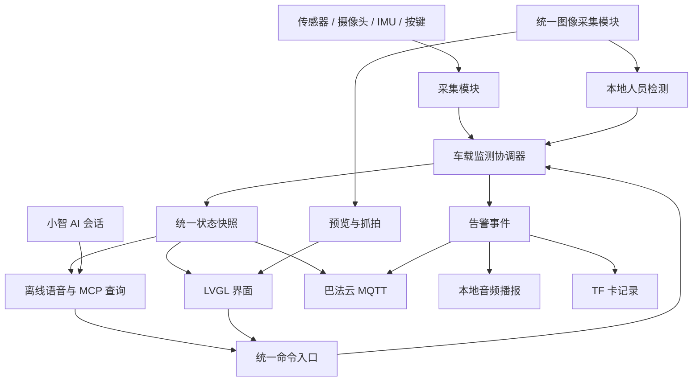

# car-ai-s3 完整项目架构、代码实现与硬件移植计划

- 文档版本：v1.0
- 更新日期：2026-10-12
- 文档状态：开发计划已确定，代码实现与阶段验收尚未启动。
- 使用方式：后续按 M0～M8 顺序开发，每完成一个阶段，补充构建、日志、实物现象及验收结果。

> 本文中的功能、接口、资源预算和量化指标属于开发目标。源码现状、构建通过与实物验证分别记录，未执行的验收不得标记为已完成。

## 1. 交付目标与开发基线

项目以**完整实物演示**为完成标准：真实环境数据采集、摄像头预览、本地人员检测、停车遗留提醒、离线语音查询、LVGL 界面、小智 AI 问答及巴法云上报形成闭环。车辆启停使用板载按键模拟，手机端使用巴法云现有控制台查看数据。

已经确定的技术路线：

- 使用 ESP-IDF 原生开发，沿用当前 ESP-IDF 5.5.3、ESP-SR 2.1.5、LVGL 9.3.0 等依赖基线。
- 保留现有小智语音与 WebSocket 通信基础，新增独立的车载监测模块。
- 温湿度采用 SHT31；模拟光照通过 ADS1115 外接 ADC 采集，复用 I²C。
- 人员识别在 ESP32-S3 本地运行，告警判断不依赖云端。
- 默认进入本地监测模式，通过语音、屏幕或按键切换小智问答。
- 覆盖触摸、IMU、TF 卡及按键等尚未完成移植或联调的板载功能。

当前结论来自源码、配置与硬件资料审查。现有工程提供了 LCD、摄像头、音频、小智通信和温湿度查询接口；温湿度仍为模拟数据，尚无本次验证过的构建及实物运行结果。

首先处理以下基线问题：

1. 重新识别实际串口，修正失效的 COM17 配置和 clangd 的旧工程路径。
2. 核对 Flash 配置中 QIO 选择项与 `"dio"` 字符串的不一致，通过 Menuconfig 重新生成一致配置，并固化默认值。
3. 将 GPIO48 从错误的 LED 定义中移除，保留给 TF 卡 CMD。
   （后续更新：LED 定义与服务已在 M4 阶段**整体删除**——LED 用的 GPIO10 与触摸中断 CTP_INT 同脚、互斥，且本项目不需要 LED，详见 3.1）
4. 工程配置审查将 Kconfig 的“未设置”按禁用处理，记录现有自检脚本的 Quad PSRAM 误报。
5. 重建工程内的引脚占用表，排除资料中不合法的 GPIO49～GPIO63。ESP32-S3 的 GPIO 编号范围最高为 GPIO48。

## 2. 软件架构与核心接口

采用“**硬件驱动 → 数据采集 → 监测规则 → 交互与上报**”结构。新增 `components/car_monitor` 承载车载业务；现有 `Application` 负责启动和小智会话集成，不再直接管理环境采集与告警规则。

### 2.1 模块职责

| 模块 | 负责的行为 | 接口与约束 |
|---|---|---|
| 硬件适配 | I²C、IO 扩展、LCD、触摸、音频、摄像头、IMU、TF 卡初始化 | 统一描述资源占用；初始化返回明确状态，非关键外设故障不导致整机重启 |
| 环境采集 | SHT31 读取、ADC 采样、滤波、光照标定 | 输出数值、采样时间和有效性；读取失败保留故障状态 |
| 图像采集 | 预览、人员识别、抓拍共用摄像头 | 单一采集者；向消费者交付带所有权的 `FrameHandle` |
| 人员检测 | 图像预处理、模型推理、检测结果过滤 | 输出帧序号、时间、人数、置信度及有效性，不直接操作屏幕或播放声音 |
| 监测协调器 | 车辆演示状态、遗留判断、环境异常和告警生命周期 | 唯一业务状态写入者；使用有界队列接收命令和采集结果 |
| 语音模块 | 离线指令、小智会话切换、播报优先级 | 复用同一音频输入链路；由统一播放入口管理扬声器 |
| 界面与云端 | 展示状态、发布数据、转交用户命令 | 读取同一份快照，不自行读取传感器或推导告警 |
| 存储与诊断 | 告警记录、抓拍文件、运行指标 | 后台执行；存储失败不阻塞监测 |

### 2.2 对外接口

车载模块保持三个主要入口：

- `Start(dependencies)`：注入采集、音频、时钟和存储依赖，启动监测。
- `Submit(command)`：异步提交命令，返回接受、队列忙或参数错误。
- `GetSnapshot()`：取得一致的状态副本，不触发硬件访问。

核心类型统一为：

- **`CarSnapshot`**：环境数值及有效性、车辆状态、人员状态、告警、语音模式、网络状态和故障标志。
- **`FrameHandle`**：图像尺寸、像素格式、帧序号、采集时间及缓冲所有权。
- **`AlertEvent`**：事件编号、类型、触发时间、活动／确认／解除状态。
- **`CarCommand`**：查询环境、播放提示、确认告警、切换车辆演示状态和切换语音模式。

新增 MCP 工具使用 `self.car.*` 命名，包含环境查询、状态查询、告警查询和确认告警。现有温湿度查询工具保留为兼容入口，统一读取真实环境快照；旧教学介绍与文字伪播报工具退出车载固件。

### 2.3 状态与规则默认值

车辆、人员、告警和语音会话分别建模，避免把“正在聊天”当作监测状态：

| 状态或规则 | 默认行为 |
|---|---|
| 车辆状态 | `RUNNING / PARKED`；启动默认 RUNNING，由用户明确切换（当前入口为 MCP 工具 `self.car.toggle_vehicle_state`） |
| 人员状态 | `UNKNOWN / EMPTY / PRESENT`；检测故障、结果过期或画面质量不足进入 UNKNOWN |
| 停车遗留 | 切换 PARKED 后等待 15 秒；最近 5 个有效结果中至少 3 次有人，触发告警 |
| 遗留解除 | 连续 10 秒获得有效的无人结果，或切回 RUNNING |
| 温度异常 | ≥45℃ 持续 5 秒触发；≤42℃ 持续 10 秒解除 |
| 湿度异常 | ≥80% 持续 10 秒触发；≤75% 持续 10 秒解除 |
| 告警确认 | 静音当前事件 30 秒，保留界面告警及云端状态；新的告警事件仍正常提示 |
| 数据有效期 | 温湿度 6 秒、光照 2 秒、人员检测 2 秒；过期值显示失效标记 |

IMU 输出“运动／静止”辅助状态，不替代车辆启停输入。阈值和延时可在设置页面修改，写入 NVS。

## 3. 硬件移植与资源安排

### 3.1 硬件移植矩阵

SHT31 使用数字 I²C 接口读取温湿度；ADS1115 提供 I²C 接口的 16 位 ADC，用于采集模拟光照。两者统一使用 3.3 V 供电。

| 硬件 | 接入与移植方案 | 完成判据 |
|---|---|---|
| 共享 I²C | SDA=GPIO1、SCL=GPIO2，复用当前总线；设备地址文档统一使用 7 位格式，驱动需要的地址格式由适配层转换 | 所有外设并发访问稳定，超时可以恢复 |
| SHT31 | 地址 0x44，每 2 秒读取一次，校验 CRC，异常时标记数据失效 | 真值随环境变化；拔掉传感器后界面与语音报告故障 |
| ADS1115＋光敏电阻 | 地址 0x48，AIN0 接光敏分压电路；10 Hz 采样、滑动平均；设置页完成暗／亮两点标定 | 输出相对光照 0～100%，明确单位，不标成未经校准的 lux |
| PCA9557 | 统一管理 LCD_CS、PA_EN、DVP_PWDN；输出影子寄存器与互斥锁保护更新 | LCD、功放及摄像头控制不会相互覆盖 |
| LCD＋触摸 | 保留 ST7796、480×320；完成 FT6X36 探测、轮询和坐标变换；背光极性通过实物验证固化 | 四角触摸、按钮、屏幕旋转和亮度控制正常 |
| 摄像头 | 沿用现有 DVP 引脚，记录实际传感器 PID；统一 RGB565 字节序，使用 320×240 图像 | 连续预览、识别和抓拍同时运行，无缓冲被提前释放 |
| 音频 | 保留 I2S 与板载 Codec；两路麦克风分别验收；默认单麦、半双工，未查明的 AEC 参考通道不启用 | 本地录音、播放、查询播报及网络问答均有实物与日志证据 |
| 按键 | GPIO11(SW3) 短按循环切换屏幕（聊天→数据→摄像头）；GPIO0(BOOT) 短按切换语音模式 | 去抖与复用行为正常 |
| QMI8658A | 地址 0x6A，完成标识读取、加速度／陀螺仪配置及周期采样 | 静止、移动和转动状态可以观察并记录 |
| TF 卡 | SDMMC 1 位模式：CLK=47、CMD=48、DAT0=21；FAT32；保存最近 100 条告警和 20 张告警照片 | 拔卡、满卡、写入失败均不阻塞核心功能 |

GPIO35／36／37 保留给模组内部 Octal PSRAM；H1 扩展器 IO 不用于原生 ADC、I2S 或摄像头信号。新增驱动不得在可恢复的 NACK、CRC 或读写超时上直接调用整机终止逻辑。

**GPIO10 专用于触摸中断（CTP_INT），不再驱动 LED**：原 LED 服务（`led_ctrl` + `self.led.*` MCP 工具）已整体删除。原因：本板 LED 与触摸中断共用 GPIO10，点亮 LED 等于把该脚改成推挽输出、顶掉中断式触摸；本项目不需要 LED，二者冲突时保留触摸。该脚仍按原理图接在触摸 IC 的 INT 上，配置（`int_gpio_num = GPIO_NUM_10`）未变动。

**车辆状态切换与告警确认没有物理按键**：GPIO11 已被 SW3 占用（切屏），摄像头页那颗屏幕按钮也已移除，故这两个动作当前只能走 MCP 工具——`self.car.toggle_vehicle_state`（行驶中 ⇄ 停车）与 `self.car.confirm_alert`（确认告警）。屏幕按钮的接线（`CarUIHelper::OnToggleVehicle` / `OnConfirmAlert`）仍保留，将来可随时恢复控件。

### 3.2 视觉与语音资源

- 人员检测选用 `pedestrian_detect 0.3.2` 的 **PICO_S8_V1**，配套固定 ESP-DL 3.3.13。官方组件支持 ESP32-S3 和 Flash 模型分区加载。
- 离线指令选用**中文 MultiNet5 Q8**。官方基准的 PSRAM 占用约 2310 KB，适合作为本项目的初始预算。保留一个共享 AFE，避免继续叠加多套音频前端。
- 硬件音频采样经现有重采样链路处理后，向离线识别提供 16 kHz、16 位单声道数据。
- 默认预览 5 FPS、人员推理 2 次／秒；小智会话期间推理降至 1 次／秒，监测和告警继续运行。
- 使用固定图像缓冲池和有界音频队列。DMA 缓冲保留在内部 RAM，图像、模型和较大缓存放入 PSRAM。

任务分配默认值：

| 任务组 | 核心与优先级安排 |
|---|---|
| 音频输入、输出与 AFE | Core 1，高优先级；输入 8、输出 7、AFE／指令处理 6 |
| LVGL | Core 1，优先级 3；统一在 LVGL 上下文更新控件 |
| 监测协调器 | Core 0，优先级 5 |
| 摄像头采集 | Core 0，优先级 3 |
| 环境采集、云端工作 | Core 0，优先级 2 |
| 人员推理、TF 存储 | Core 0，优先级 1 |

### 3.3 Flash 分区

保留双 OTA 分区，本期交付采用 USB 全量更新，关闭上游自动升级。重新分配 16 MB Flash：

| 分区 | 偏移 | 大小 |
|---|---:|---:|
| NVS | `0x9000` | `0x6000` |
| OTA 数据／PHY | `0xF000`／`0x11000` | `0x2000`／`0x1000` |
| 语音模型 `model` | `0x20000` | `0x3E0000` |
| `ota_0` | `0x400000` | 5 MiB |
| `ota_1` | `0x900000` | 5 MiB |
| 视觉模型 `pedestrian_det` | `0xE00000` | 1 MiB |
| 中文语音及资源 | `0xF00000` | 1 MiB |

构建检查验证分区无重叠、模型大小和 SHA-256、资源完整性以及固件占用。首次迁移先备份现有配置，再进行完整烧录与重新配置。

## 4. 完整代码实现顺序

所有阶段都必须得到可编译的固件；涉及硬件的阶段增加串口日志与实物现象验收。

| 阶段 | 代码与移植工作 | 阶段交付 |
|---|---|---|
| **M0：建立基线** | 修正开发环境路径、配置一致性和引脚定义；恢复依赖；验证 Flash、PSRAM、LCD、摄像头与音频基础 | 可重复构建和烧录的基线固件、硬件状态清单 |
| **M1：建立车载核心** | 实现快照、命令队列、告警事件、故障标志与依赖注入；将本地启动和联网／激活流程分离 | 无 Wi-Fi、无云端账号时，本地监测框架仍可启动 |
| **M2：完成真实采集** | 移植 SHT31、ADS1115、光照滤波与标定；完成共享 I²C、PCA9557、按键、触摸及 IMU | 屏幕显示真实数据和明确故障状态，模拟数据仅保留在测试配置 |
| **M3：完成车载界面与规则** | 建立环境、预览、状态、设置及告警界面；实现停车宽限、人员判断、阈值滞回、确认和解除 | 按键模拟车辆启停，界面和规则形成闭环 |
| **M4：完成图像与人员识别** | 统一摄像头所有权；完成模型加载、预处理、推理、结果过滤和画面标注；接入遗留规则 | 实际座位场景检测与告警，输出漏检／误检记录 |
| **M5：完成本地与在线语音** | 共享 AFE；接入固定离线指令；制作中文数字、单位和提示音频包；实现播放仲裁；适配小智 MCP 查询与模式切换 | 断网查询温度可播报真实数值，联网后可进行小智问答 |
| **M6：完成巴法云闭环** | 实现独立 MQTT 客户端、鉴权配置、周期上报、告警发布、断线重连及有界补发；完成手机查看流程 | 手机查看环境、车辆、人员和告警状态，小智与巴法云可同时连接 |
| **M7：完成存储与诊断** | 移植 TF 文件系统、告警记录和 JPEG 保存；实现轮转、无卡降级、堆内存与任务指标记录 | 本地告警记录和抓拍可追溯，存储异常不影响监测 |
| **M8：完成整机验收** | 执行故障注入、长时间运行及综合压力验证；收敛资源；导出烧录包、架构说明、移植矩阵及演示步骤 | 可独立复现的完整实物项目 |

M4 的默认模型必须接受实际摄像头场景测试。若达不到验收指标，使用同一 PICO 架构进行场景微调和 INT8 导出，保持图像及检测接口不变，重新执行相同验收。

### 4.1 语音与界面行为

离线模式固定支持：

“查询温度”“查询湿度”“查询光照”“查询状态”“播放提示”“开始聊天”“确认告警”。

唤醒后识别窗口为 6 秒，超时返回待机。中文数字与单位使用预录音频片段拼接，支持真实数值和故障提示；普通文字不会再传给 OGG 播放函数。

音频优先级为：

**人员遗留告警 → 环境告警 → 本地查询播报 → 小智问答 → 普通提示。**

高优先级告警停止当前低优先级播放，清理对应队列后播报。小智会话退出方式固定为屏幕按钮或 BOOT 短按。

主界面采用 480×320 横屏布局：上方状态栏、左侧摄像头画面、右侧环境与人员数据、下方操作按钮。环境、摄像头、小智和巴法云的状态分别展示。

### 4.2 云端接口

巴法云使用独立 MQTT 客户端，连接 `bemfa.com:9503`，采用 AppID／AppSecret 鉴权和设备独立 ClientID。

> **实现偏差（已落地，见 `main/car_cloud.h`）**：① 端口取 **9501 明文**而非 9503——本工程 Mqtt 封装只在 8883 启用 TLS，9503 用它连不上，且 TLS 会额外吃 30~50KB 内部 RAM；② 鉴权改用巴法云"方式一"（**用户私钥直接作 clientId**，账号密码留空），省掉 appID/secretKey 两层配置；③ 主题名**只能含字母和数字**（巴法云新建主题时校验"主题只能包含字母和数字"），故固定为 `env / state / alarm / online`（可选字母数字前缀，NVS `car_cloud/prefix`），不再用 MAC 后六位拼下划线式前缀；④ 周期数据用 `/up`（只更新云端、不推送，控制台同样能看到；实测控制台 online 卡片就是 `/up` 负载显示出来的），仅告警事件用 `/set` 推送。

主题统一使用设备 MAC 后六位组成的前缀，分为：

- `env`：温度、湿度、相对光照、采样时间与有效性。
- `state`：车辆状态、人员状态、告警和故障标志。
- `alert`：告警发生、确认及解除事件。
- `online`：在线状态及遗嘱消息。

采用版本化 JSON，包含 `v`、`boot_id`、`seq` 和时间信息；数值失效时发送 `null`。周期上报间隔 5 秒，告警变化立即上报，默认 QoS 1。普通状态只保留最新快照，未上报告警最多缓存 32 条。

凭据通过设备配置流程写入 NVS，日志隐藏敏感字段。手机浏览器打开巴法云控制台作为固定验收入口，本期不开发独立手机前端。

## 5. 验证、完成标准与最终交付

验证分三层：纯业务逻辑测试、驱动／接口集成测试、整机实物测试。

必须覆盖：

- **业务规则**：停车宽限、连续检测、UNKNOWN 状态、温湿度滞回、告警确认、解除和模式切换。
- **数据一致性**：界面、离线查询、MCP 和 MQTT 读取同一快照；传感器故障不会回退为模拟数值。
- **图像生命周期**：预览、推理、抓拍和网络图像请求并发时，无缓冲提前释放、旧帧被覆盖或重复初始化摄像头。
- **硬件异常**：传感器断开、摄像头故障、I²C 超时、TF 缺失／满卡及网络断开均有明确状态，核心任务继续运行。
- **音频冲突**：小智正在播报时触发遗留告警，本地告警能优先播放；恢复后没有残留音频。
- **网络恢复**：Wi-Fi 或巴法云连接恢复后重新上报最新状态，补发缓存告警；不会阻塞采集和界面。

### 5.1 量化验收

| 项目 | 验收目标 |
|---|---|
| 离线启动 | 无网络时，10 秒内进入本地可操作界面 |
| 环境显示 | 温湿度至少每 2 秒更新，故障在有效期内被标记 |
| 实时画面 | 正常监测时预览达到 5 FPS；语音并发场景至少 2 FPS |
| 人员检测 | 使用至少 100 张独立场景图像，包含正面、侧面、坐姿和空座；召回率≥90%，负样本误报率≤5% |
| 遗留提醒 | 宽限结束后，满足连续检测条件时 5 秒内触发 |
| 离线语音 | 七类指令分别测试 10 次，安静环境识别成功率≥90%；命中后 1 秒内开始播报 |
| 手机查看 | 网络正常时，数据更新延迟≤10 秒 |
| 稳定运行 | 连续运行 24 小时，无异常重启、看门狗复位或持续内存下降 |
| 资源余量 | 综合峰值场景下内部空闲堆≥64 KiB、PSRAM 空闲≥512 KiB，任务栈余量≥25% |

### 5.2 最终交付

最终交付包括：完整源码、锁定的依赖与默认配置、固件／模型／资源全量烧录包、硬件接线与移植矩阵、模块接口说明、测试记录、故障处理说明及实物演示步骤。

项目文档和界面继续采用通用 ESP32-S3 车载终端名称。完成状态按实际测试证据更新，确保“已实现”“已通过实物验证”和“后续扩展”各自有明确依据。

## 6. 阶段执行记录

以下任务当前均未开始；后续完成代码、构建与对应验收后再勾选。

- [ ] M0：建立基线。
- [ ] M1：建立车载核心。
- [ ] M2：完成真实采集。
- [ ] M3：完成车载界面与规则。
- [ ] M4：完成图像与人员识别。
- [ ] M5：完成本地与在线语音。
- [ ] M6：完成巴法云闭环。
- [ ] M7：完成存储与诊断。
- [ ] M8：完成整机验收。

每阶段按以下字段记录：

| 字段 | 记录要求 |
|---|---|
| 修改范围 | 模块、文件及配置变更 |
| 构建结果 | SDK／依赖版本、构建命令、实际固件路径和结果 |
| 烧录结果 | 实际设备端口、固件标识及烧录校验日志 |
| 实物现象 | 屏幕、摄像头、音频、传感器等可观察结果 |
| 验收证据 | 测试记录、串口日志、照片或录像的位置 |
| 剩余问题 | 未完成事项及下一阶段处理方式 |

## 7. 技术资料入口

以下资料用于后续实现时核对接口与参数；涉及 API 时应结合锁定依赖版本阅读。

- [ESP-IDF 5.5.3：ESP32-S3 GPIO](https://docs.espressif.com/projects/esp-idf/en/v5.5.3/esp32s3/api-reference/peripherals/gpio.html)
- [ESP-SR：离线命令识别](https://docs.espressif.com/projects/esp-sr/en/latest/esp32s3/speech_command_recognition/README.html)
- [ESP-SR：资源与性能基准](https://docs.espressif.com/projects/esp-sr/en/latest/esp32s3/benchmark/README.html)
- [人员检测组件 0.3.2](https://components.espressif.com/components/espressif/pedestrian_detect/versions/0.3.2/readme)
- [ESP-DL 3.3.13](https://components.espressif.com/components/espressif/esp-dl/versions/3.3.13/readme)
- [TI ADS1115 产品与数据手册](https://www.ti.com/product/ADS1115)
- [巴法云 MQTT 接入文档](https://cloud.bemfa.com/docs/src/mqtt.html)
